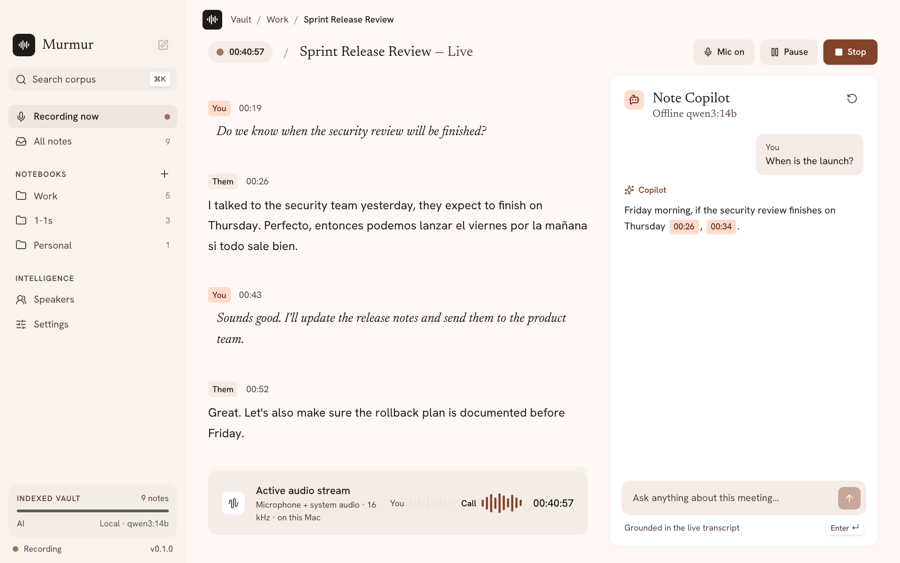
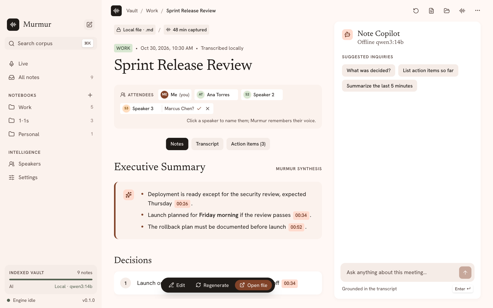
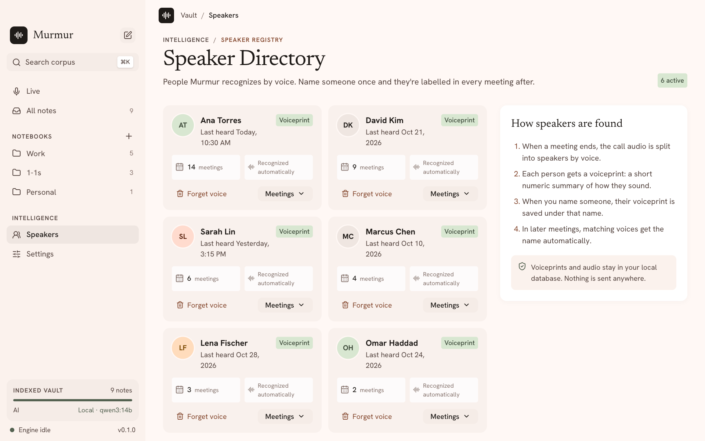
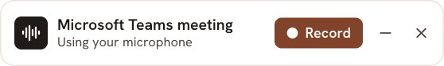
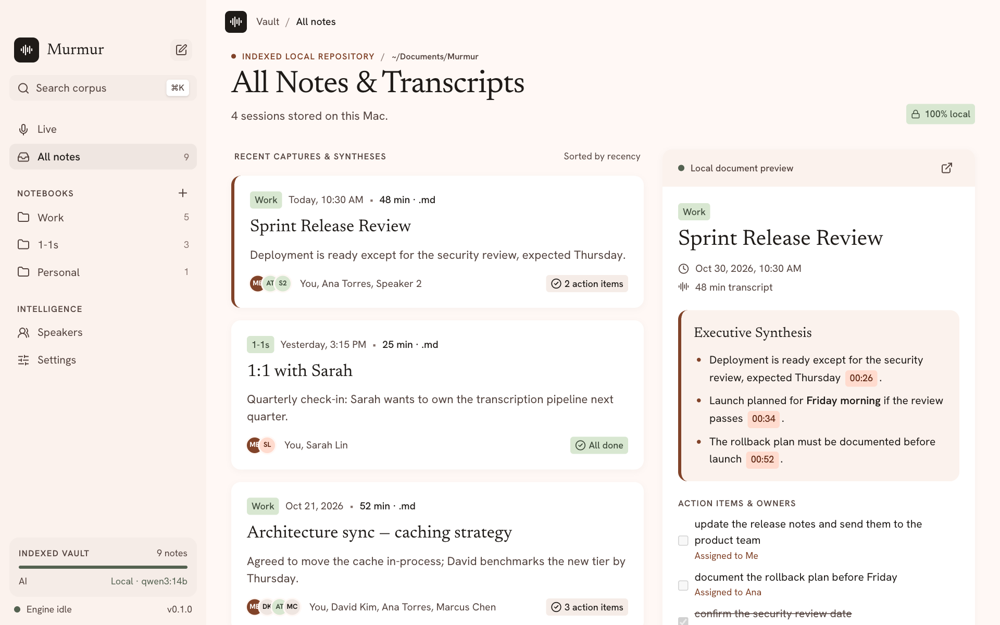

# Murmur

Local-first meeting transcription and notes for macOS: Teams, Google Meet and Slack.
Transcription runs on-device with Whisper; summaries and live Q&A use local Qwen via
Ollama, or your own Claude/Gemini API key.

<picture>
  <source media="(prefers-color-scheme: dark)" srcset="docs/screenshots/live-dark.png">
  
</picture>

- **Live transcript** of your microphone and the call, including meetings that switch
  between languages, with answers to questions about the meeting as it happens.
- **Notes when it ends:** summary, decisions, action items and open questions, each linked
  to the moment it was said. Every session is a Markdown file in a folder you choose,
  ready for Obsidian or any editor.

<picture>
  <source media="(prefers-color-scheme: dark)" srcset="docs/screenshots/notes-dark.png">
  
</picture>

- **Speakers by voice:** name someone once and they're recognized in later meetings.
  Murmur suggests names for voices it knows and flags names that don't fit a voice.

<picture>
  <source media="(prefers-color-scheme: dark)" srcset="docs/screenshots/speakers-dark.png">
  
</picture>

- **Meeting detection:** when Teams, Slack, Zoom or a browser call starts using the
  microphone, a small card offers to record. Nothing is recorded until you say so.

<picture>
  <source media="(prefers-color-scheme: dark)" srcset="docs/screenshots/popup-dark.png">
  
</picture>

- **Search across every meeting** and browse them by notebook.

<picture>
  <source media="(prefers-color-scheme: dark)" srcset="docs/screenshots/library-dark.png">
  
</picture>

Audio never leaves your Mac.

## Install

Requires a Mac with Apple silicon and macOS 14.4 or later.

1. Download `Murmur_<version>_aarch64.dmg` from the
   [latest release](https://github.com/DanielPenalozaB/murmur/releases/latest), open it
   and drag Murmur to Applications.
2. Murmur isn't notarized by Apple yet, so the first launch is blocked. Open it once,
   then go to **System Settings → Privacy & Security** and click **Open Anyway**.
   (Or run `xattr -dr com.apple.quarantine /Applications/Murmur.app`.)
3. On first run, Murmur downloads its speech models (about 770 MB) and asks for
   microphone and system-audio access.
4. For notes and questions, install [Ollama](https://ollama.com) and pull a model
   (for example `ollama pull qwen3:14b`), or add a Claude or Gemini API key in Settings.

Each update is a new build, so macOS may ask for microphone and system-audio access again.

## Develop

```sh
nvm use                  # Node 22
corepack enable          # pnpm
pnpm install
pnpm tauri dev
```

Requires Rust (rustup), Xcode Command Line Tools and cmake. See
[docs/ARCHITECTURE.md](docs/ARCHITECTURE.md).

To release, set the same version in `src-tauri/tauri.conf.json`, `Cargo.toml` and
`package.json`, merge it, then push a matching tag (`git tag v0.2.0 && git push origin v0.2.0`).
The Release workflow builds the app and publishes the `.dmg` and `.zip`.

## Contributing

Issues and pull requests are welcome. See [CONTRIBUTING.md](CONTRIBUTING.md); please report
security or privacy problems privately as described in [SECURITY.md](SECURITY.md).

## License

Murmur is source-available under the [PolyForm Shield License 1.0.0](LICENSE.md),
copyright Daniel Penaloza. You may use, modify and share it, including at work, and fork
it to extend it, as long as you keep the `Required Notice` (crediting the author and
<https://github.com/DanielPenalozaB/murmur>) and the license with every copy. You may not
sell Murmur or a version of it, or offer it as a product or service that competes with it.
